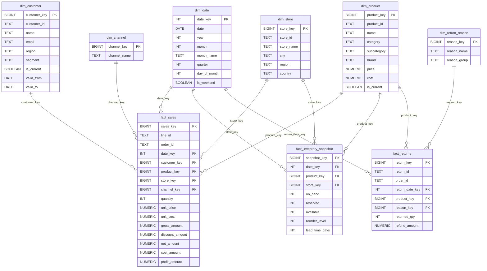
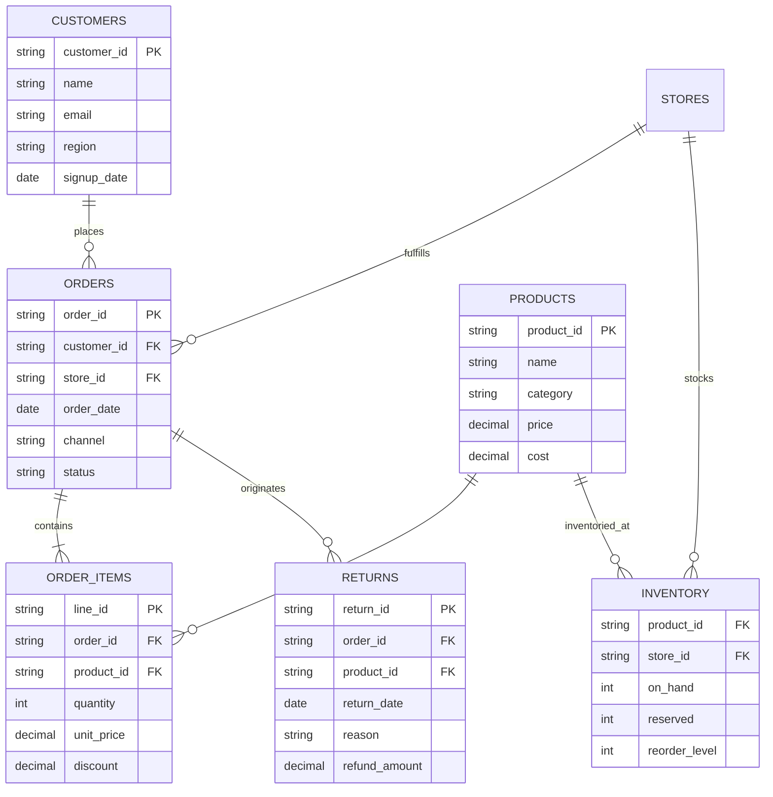

# Entity Relationship Diagram (ERD)
**Retail Analytics Platform — Relational & Dimensional Architecture**

This document provides both the **Source Operational Model** (3NF Ingestion) and the **Dimensional Warehouse Star Schema** (Kimball Model) for the platform.

---

## 1. Dimensional Warehouse Architecture (Star Schema)

The analytical data warehouse in PostgreSQL is organized under the `dw` schema, optimized for sub-second analytical queries and Power BI DirectQuery / Import modes.

---

## 2. Operational Source ERD (Staging / Raw)

Before ETL transformation, the operational transactions are structured across normalized relational tables:

---

## 3. Dimensional Design Decisions

1. **Slowly Changing Dimensions (SCD Type 2)**:
   - `dim_customer` and `dim_product` track historical attribute changes (e.g. customer relocation across regions, product price or category revisions).
   - Columns `is_current`, `valid_from`, and `valid_to` enable point-in-time revenue attribution.
2. **Fact Table Partitioning**:
   - `fact_sales` is range-partitioned by monthly integer keys (`date_key`), ensuring PostgreSQL automatically prunes partitions during time-bounded queries.
3. **Surrogate Keys**:
   - Every dimension utilizes an auto-incrementing surrogate integer/bigint key (`product_key`, `customer_key`), decoupling analytics queries from changing upstream business keys.
